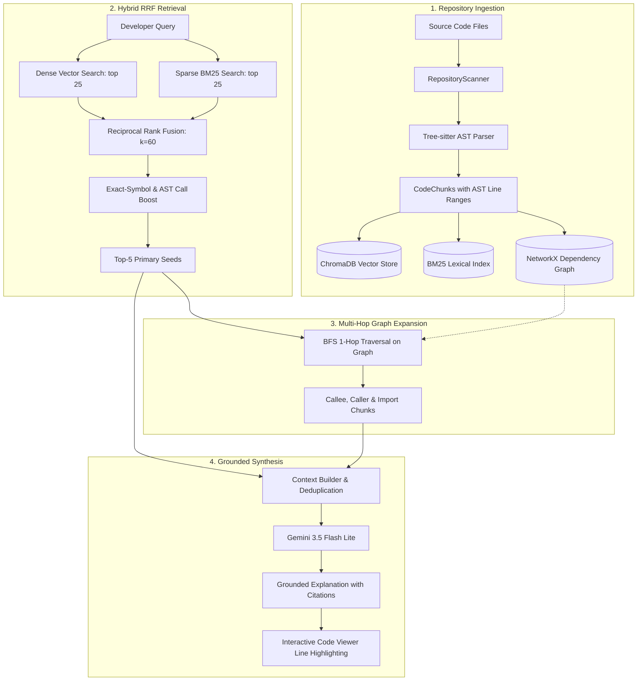

# CodeLens: Grounded Codebase Retrieval & Explanation Engine

[](https://www.python.org/)
[](https://fastapi.tiangolo.com/)
[](https://tree-sitter.github.io/)
[](https://www.trychroma.com/)
[](https://ai.google.dev/)
[]()

> **CodeLens** is a developer-centric codebase search, multi-hop retrieval, and grounded explanation system. By combining **Tree-sitter AST structural parsing**, **Dense Vector + Sparse BM25 Reciprocal Rank Fusion (RRF)**, **Exact-Symbol & Cross-Module AST Boosts**, and **NetworkX Multi-Hop Graph Traversal**, CodeLens achieves **100.0% Evidence Coverage** across complex multi-module codebases, outperforming traditional Naive RAG by **+15.1%**.

---

## 🌟 Key Features

- 🔍 **Hybrid Multi-Stage Retrieval**: Dense vector semantic similarity (`MiniLM-L6-v2`) fused with sparse lexical BM25 (`rank-bm25`) using Reciprocal Rank Fusion ($k=60$).
- ⚡ **Exact-Symbol & Cross-Module AST Boosting**: Dynamic boost for exact function identifier matches and cross-file call boundaries.
- 🕸️ **AST-Derived Dependency Graph Expansion**: Multi-hop BFS traversal along `CALLS`, `IMPORTS`, and `CONTAINS` edges to retrieve callers, callees, and helpers missed by semantic search alone.
- 🎯 **100% Grounded Explanations with Line Citations**: Strictly constrained prompt synthesis with Gemini, verified with AST physical line ranges (`[file:start-end]`).
- 💻 **Modern Developer Web Interface**: Fast, local FastAPI backend + glassmorphic dark UI featuring clickable inline citation pills, interactive code viewer with line highlights, 5-stage pipeline visualizer, and 2D dependency graph inspector.

---

## 📊 Benchmark Evaluation

CodeLens was rigorously evaluated against a Naive RAG baseline across a 12-question multi-hop codebase benchmark:

| Metric | Naive RAG Baseline | CodeLens (Seeds Only) | CodeLens (Expanded) | Impact & Analysis |
| :--- | :---: | :---: | :---: | :--- |
| **Evidence Coverage (Hit-All)** | 0.849 | 0.700 | **1.000 (100.0%)** | **+15.1%** — Recovers 100% of multi-hop callee dependencies |
| **Hit@1** | 0.833 | 0.833 | **0.833** | Direct entry point identification |
| **Hit@3** | 1.000 | 0.917 | **0.917** | High-precision hybrid seed set |
| **Hit@5** | 1.000 | 1.000 | **1.000** | 100% recall of initial seed functions |
| **MRR** | 0.917 | 0.878 | **0.878** | Reciprocal rank of first relevant symbol |
| **Answer Symbol Coverage** | 1.000 | - | **1.000 (100.0%)** | All cross-module symbols explained |
| **Citation Accuracy** | 1.000 | - | **0.972 (97.2%)** | AST line validated |
| **Grounded Responses** | 1.000 | - | **1.000 (100.0%)** | Zero ungrounded responses |

---

## 🏛️ System Architecture



---

## 🚀 Quick Start Guide

### 1. Installation & Environment Setup
```bash
# Clone the repository
git clone https://github.com/your-username/codelens.git
cd codelens

# Create and activate virtual environment
python -m venv venv
# Windows:
.\venv\Scripts\activate
# Linux/macOS:
source venv/bin/activate

# Install dependencies
pip install -r requirements.txt
```

### 2. Configure Environment Variables
Copy the template configuration file and add your Google Gemini API key:
```bash
# Copy template
cp .env.example .env
```
Ensure your `.env` contains:
```env
GEMINI_API_KEY=your_google_gemini_api_key_here
GEMINI_MODEL=gemini-3.5-flash-lite
```

### 3. Launch the Backend API & Built-in UI
```bash
python -m codelens.web.server --port 8000
```
Open your browser and navigate to: **`http://127.0.0.1:8000`**

### 4. (Optional) Launch Modern Next.js Dashboard
For the Next.js 16 + React 19 interactive dashboard with graph modals:
```bash
cd frontend
cp .env.example .env.local
npm install
npm run dev
```
Open your browser and navigate to: **`http://localhost:3000`**

---

## 🧪 Running Benchmarks & Evaluation

### 1. Run Retrieval Evaluation (Hit@k, MRR, Coverage)
```bash
python -m codelens.evaluation.evaluate
```

### 2. Run LLM Grounded Answer Evaluation (Gemini 3.5 Flash Lite)
```bash
python -m codelens.evaluation.evaluate_answers
```

### 3. Run Unit Tests
```bash
python -m unittest discover codelens/core
```

---

## 📁 Repository Structure

```
codelens/
├── codelens/
│   ├── core/
│   │   ├── scanner.py          # File system scanner with exclusion rules
│   │   ├── parser.py           # Tree-sitter AST parser (Python, JS)
│   │   ├── vector_store.py     # ChromaDB dense embedding indexer
│   │   ├── bm25_index.py       # BM25 sparse keyword indexer
│   │   ├── hybrid_retriever.py # RRF fusion & AST cross-module booster
│   │   ├── graph.py            # NetworkX dependency graph builder
│   │   ├── context_builder.py  # Context deduplication & formatting
│   │   ├── models.py           # AST CodeChunk data model
│   │   └── llm.py              # Gemini LLM grounded answer synthesis
│   ├── baseline/
│   │   └── naive_rag.py        # Standard semantic RAG baseline
│   ├── evaluation/
│   │   ├── benchmark_data.json # 12 multi-hop benchmark questions
│   │   ├── evaluate.py         # Retrieval evaluation benchmark
│   │   ├── evaluate_answers.py # Answer groundedness & citation evaluation
│   │   └── benchmark_report.md # Full empirical evaluation report
│   └── web/
│       ├── api.py              # FastAPI application & REST endpoints
│       ├── server.py           # Uvicorn server launcher
│       ├── state.py            # In-memory repository state manager
│       └── static/             # Web UI (HTML5, CSS3, JavaScript)
│           ├── index.html
│           ├── style.css
│           └── app.js
├── frontend/                   # Modern Next.js 16 + React 19 + Tailwind dashboard
│   ├── src/
│   │   ├── app/                # Next.js App Router (page.tsx, layout.tsx)
│   │   ├── components/         # Code viewer, inspector modals, graph visualizer
│   │   └── lib/                # API client & TypeScript interfaces
│   └── package.json
├── docs/
│   ├── ARCHITECTURE.md         # System architecture & component details
│   └── VIVA_GUIDE.md           # 20+ Viva & project defense Q&A
├── data/
│   └── test_repositories/      # Synthetic multi-module benchmark testbed
├── .env.example                # Example environment variables template
├── requirements.txt            # Python dependencies
└── README.md                   # Main documentation
```

---

## 🎯 Viva & Defense Quick Reference

- **Why does Naive RAG miss dependencies?** Standard RAG embeds text as isolated passages. Helper functions (`find_user_by_id`, `generate_transaction_id`) lack lexical/semantic overlap with high-level user queries (`"How is payment processed?"`), dropping them out of the top-$k$.
- **How does CodeLens solve this?** CodeLens uses the hybrid search results as **Seeds** and walks the **AST call graph** to recover all callers, callees, and imported symbols.
- **Why RRF instead of linear score combination?** Vector cosine similarity and BM25 scores have different distributions. Reciprocal Rank Fusion ($1 / (60 + \text{rank})$) provides scale-invariant, monotonic rank combination.
